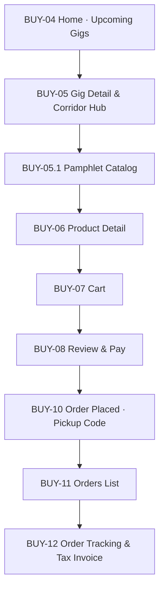
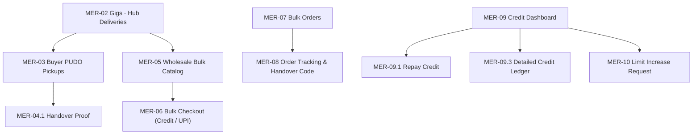
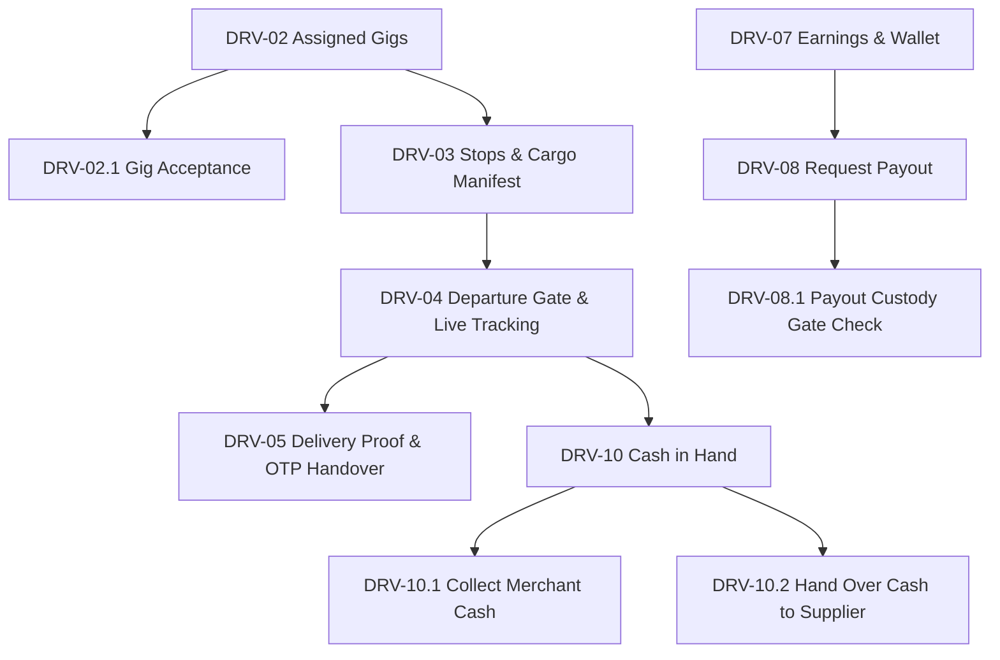
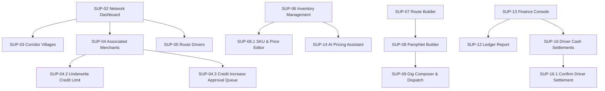
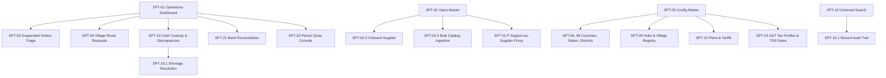
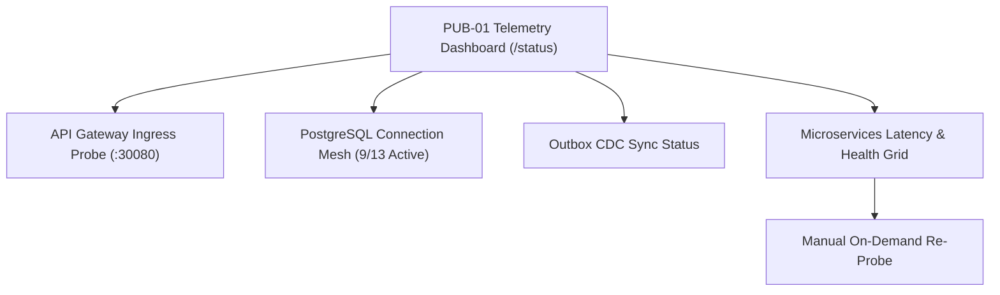

# Logged-In User Navigation Use Cases Specification

This document defines the authoritative, role-based navigation architecture and end-to-end use cases for every logged-in user persona in Logikchain, synthesized from [`constitution/wireframes/Navigation.md`](../constitution/wireframes/Navigation.md), [`constitution/wireframes/Foundations.md`](../constitution/wireframes/Foundations.md), and the Web PWA application architecture.

---

## 1. Global Navigation Architecture & Persona Stance

Following the constitutional rule in `constitution/Logikchain_Architecture.md` §2a, role prefixes are **separate HTML entries** on a single kernel. Each persona receives a role-specific navigation shell and bottom/side bar tabs, while sharing global header chrome (`SHR-00`: Voice `🔊`, Notifications `🔔`, and Profile `👤`).

| Persona Role | Role Claim | Route Prefix | Viewport Stance | Persistent Nav Bar Tabs |
|---|---|---|---|---|
| **1. Buyer (Consumer)** | `buyer` | `/` | 360px Mobile First | **Home** (`BUY-04`) · **Cart** (`BUY-07`) · **Orders** (`BUY-11`) |
| **2. Merchant (Kirana Retailer)** | `merchant` | `/m/` | 360px Mobile First | **Gigs** (`MER-02`) · **Orders** (`MER-07`) · **Credit** (`MER-09`) |
| **3. Driver (Logistics Gig Partner)** | `vehicle` | `/d/` | 360px Mobile First | **Gigs** (`DRV-02`) · **Tracking** (`DRV-04`) · **Earnings** (`DRV-07`) |
| **4. Supplier (Distributor / Brand)** | `supplier` | `/s/` | Responsive (Desktop/Tablet) | **Dashboard** (`SUP-02`) · **Gigs** (`SUP-10`) · **Inventory** (`SUP-06`) · **Finance** (`SUP-13`) |
| **5. Support & Ops Specialist** | `support` | `/x/` | 1024px Two-Pane Console (`SPT-18`) | **Ops** (`SPT-01`) · **Users** (`SPT-02`) · **Config** (`SPT-05`) · **Search** (`SPT-15`) |
| **6. Platform SRE & Infra Admin** | `sre_admin` | `/status` | Responsive High-Density | **Cluster Telemetry** · **PostgreSQL Mesh** · **Service Probes** · **Outbox Sync** |

---

## 2. Shared Header Chrome (`SHR-00`) Use Case

#### `UC-NAV-SHR`: Global Header Actions & Account Navigation
* **Applies To**: All logged-in personas.
* **Header Structure**: `[ App Logo / Brand ]` · `[ Voice Assist 🔊 ]` · `[ Alerts Bell 🔔 ]` · `[ Avatar 👤 ]`
* **Workflow**:
  1. **Voice Assist (`🔊 SHR-11`)**: User taps speaker icon; platform reads screen contents in regional dialect (Telugu, Hindi, English).
  2. **Notification Centre (`🔔 SHR-08`)**: User taps bell; opens categorized alerts:
     - Transporters: Dispatch alerts, vehicle departure clearances.
     - Merchants: Credit due dates, wholesale order dispatch updates.
     - Support: Circuit breaker halts, suspended order alerts.
  3. **Profile Menu (`👤 SHR-07`)**: Tapping avatar opens account settings overlay:
     - `SHR-07.1`: Edit Name, Phone, and Language preference.
     - `SHR-09`: Security settings (Passcode / Device 2FA).
     - `SHR-10`: Device permissions (Camera for QR/POD, Geolocation for GPS tracking).
     - `SHR-12`: Offline cache synchronization and outbox backlog viewer.
     - `SHR-07.2`: Sign out confirmation (clears session and returns to `/login`).

---

## 3. Buyer Navigation & Use Cases (`/`)

### Navigation Tree

#### `UC-NAV-BUY-01`: Rural Consumer Catalog Browsing to Order Pickup
* **Primary Actor**: Rural Citizen / Buyer (`ACT-BUY`)
* **Trigger**: User opens Logikchain PWA home screen.
* **Step-by-Step Flow**:
  1. **Landing (`BUY-04`)**: Buyer views upcoming logistics delivery gigs arriving at their local village PUDO hub (e.g. Chimakurthy Hub).
  2. **Pamphlet Discovery (`BUY-05.1`)**: Buyer taps arriving gig; browses offline-cached product pamphlet with discounted bulk staples.
  3. **Cart Assembly (`BUY-07`)**: Adds items to cart; system performs real-time stock reconciliation against cargo manifest.
  4. **Prepaid / CoD Checkout (`BUY-08` / `BUY-09`)**: Selects UPI or Cash-on-Delivery.
  5. **Pickup Security Token (`BUY-10.1`)**: Upon placement, screen generates high-contrast 4-digit pickup code + QR token.
  6. **Handover Collection (`BUY-12.5`)**: At village hub, merchant scans pickup code; buyer receives physical handover receipt.

---

## 4. Merchant Navigation & Use Cases (`/m/`)

### Navigation Tree

#### `UC-NAV-MER-01`: Wholesale Replenishment with Trade Credit
* **Primary Actor**: Rural Kirana Merchant (`ACT-MER`)
* **Trigger**: Merchant runs low on agricultural supplies or packaged goods.
* **Step-by-Step Flow**:
  1. **Supplier Discovery (`MER-02`)**: Merchant browses verified regional suppliers serving their corridor.
  2. **Bulk Order Assembly (`MER-05`)**: Selects 10x 50kg bags of fertilizer and grain.
  3. **Credit Headroom Checkout (`MER-06`)**:
     - System displays **Credit Headroom Gate**: Credit Limit ₹50,000, Utilized ₹10,000, Available ₹35,000.
     - Merchant selects *"14-Day Trade Credit"*; system creates 2-phase synchronous hold (`POST /v1/credit/holds`).
  4. **Active Orders Tracking (`MER-07` / `MER-08`)**: Merchant tracks transit status; receives SMS OTP (`948210`).
  5. **Credit Dashboard & Repayment (`MER-09` / `MER-09.1`)**: Merchant monitors outstanding balance and repays via instant UPI or cash to visiting route driver.

---

## 5. Driver / Transporter Navigation & Use Cases (`/d/`)

### Navigation Tree

#### `UC-NAV-DRV-01`: Cargo Departure Clearance to OTP Custody Handover
* **Primary Actor**: Delivery Gig Partner / Transporter (`ACT-DRV`)
* **Trigger**: Driver arrives at regional distribution warehouse to load truck.
* **Step-by-Step Flow**:
  1. **Assigned Gig Manifest (`DRV-02` / `DRV-03`)**: Driver reviews trip `#TRP-104` route (Ongole → Chimakurthy → Podili).
  2. **Vehicle Departure Gate (`DRV-04`)**:
     - Driver must check: Cargo count verified, temperature normal, waybill signed.
     - *Circuit Breaker*: If unchecked, system blocks transit start with `422 VEHICLE_DEPARTURE_GATE_FAILED`.
  3. **En-Route GPS Tracking (`DRV-04`)**: Driver navigates village drop points with offline GPS breadcrumbs.
  4. **Delivery Handover & OTP Verification (`DRV-05.2`)**:
     - Driver requests 6-digit OTP from merchant.
     - Driver inputs OTP (`948210`); system validates against `orders-service` and records merchant digital signature.
     - *Circuit Breaker*: Invalid OTP rejects custody release (`401 INVALID_HANDOVER_OTP`).
  5. **Cash Collection (`DRV-10.1`)**: Driver collects ₹15,000 cash for CoD order; cash-in-hand updates in real time.
  6. **Payout Custody Gate (`DRV-08.1`)**: Driver cannot withdraw gig earnings until unremitted cash is settled with supplier hub.

---

## 6. Supplier Navigation & Use Cases (`/s/`)

### Navigation Tree

#### `UC-NAV-SUP-01`: Wholesale Fleet Route Dispatch & Credit Governance
* **Primary Actor**: Supplier General Manager (`ACT-SUP`)
* **Trigger**: Daily stock staging and corridor dispatch scheduling.
* **Step-by-Step Flow**:
  1. **Inventory & SKU Catalog (`SUP-06`)**: Supplier updates stock levels; uses `SUP-14` AI assistant for dynamic market price recommendations.
  2. **Route & Gig Composition (`SUP-07` / `SUP-09`)**: Binds warehouse stock to delivery corridor; generates digital pamphlet and assigns driver `driver_rural_101`.
  3. **Merchant Credit Underwriting (`SUP-04.2`)**: Reviews Kirana credit requests in queue `SUP-04.3`; sets credit limits and repayment cycles (7/14/30 days net).
  4. **Cash Settlement Reconciliation (`SUP-16.1`)**: Transporter returns from corridor; supplier verifies physical cash bag against driver digital wallet, releasing driver payout hold.

---

## 7. Support & Operations Navigation & Use Cases (`/x/`)

### Navigation Tree (1024px Two-Pane Console Reflow `SPT-18`)

#### `UC-NAV-SPT-01`: Support-as-Supplier Proxy Delegation (`SPT-01.P`)
* **Primary Actor**: Support Operations Specialist (`ACT-OPS`)
* **Trigger**: Rural supplier unable to access digital terminal requests telephone-assisted stock update.
* **Step-by-Step Flow**:
  1. **Top Bar Proxy Switcher**: Operator accesses `/x/ops`; opens proxy dropdown and selects `sup_ongole_01` (Sri Lakshmi Agro).
  2. **Context Persistence**: Selection stores in `localStorage.lc_support_supplier_context`.
  3. **Scoped Mutations**: Operator updates catalog pricing and inventory.
  4. **Circuit Breaker Gate**:
     - Gateway inspects role: `user.role === 'support'`.
     - *Financial Mutation Gate*: If operator attempts payout modification, gateway immediately blocks with `403 FINANCIAL_MUTATION_PROXY_BLOCKED`.
     - Non-financial updates append immutable dual headers (`X-Actor-ID: ops_admin`, `X-On-Behalf-Of: sup_ongole_01`).

#### `UC-NAV-SPT-02`: Multi-Entity Bulk Ingestion Pre-Flight Gate (`SPT-02.5`)
* **Primary Actor**: Support Operations Specialist (`ACT-OPS`)
* **Trigger**: Onboarding a regional fertilizer manufacturer with 500+ SKUs.
* **Step-by-Step Flow**:
  1. Operator navigates to `/x/config/supplier-ingestion`.
  2. Uploads master spreadsheet; toggles 11 entity checkboxes.
  3. Clicks `"Validate & Preview"`:
     - Pre-flight dry run checks GSTIN format, HSN tax rates, and IFSC routing.
     - *Circuit Breaker*: If 14-char corrupted GSTIN found, reports `VALIDATION_FAILED` (`INVALID_GSTIN_FORMAT`) and locks commit action.
  4. If valid, commit unlocks; operator ingests 500 SKUs directly to `config_db`.

---

## 8. SRE & Infrastructure Platform Admin (`/status`)

### Navigation Tree

#### `UC-NAV-SRE-01`: Live Mesh Health & Perimeter Observability
* **Primary Actor**: Platform SRE / DevOps Administrator (`ACT-SRE`)
* **Trigger**: Production deployment verification or scheduled health monitoring.
* **Step-by-Step Flow**:
  1. Operator visits public telemetry endpoint `/status`.
  2. System queries API Gateway `:30080/health/services`.
  3. Summary cards render:
     - **API Gateway**: `CONNECTED`
     - **Active Microservices**: `9 Online` (`identity`, `orders`, `gigs`, `pamphlet`, `payments`, `credit`, `config`, `gateway`, `socialConnect`).
     - **Database Mesh**: `9/13 Active` isolated PostgreSQL connection pools.
  4. Operator hovers over individual service rows to inspect p95 latency and database connection errors.
  5. Operator clicks `"Refresh All Checks"` to perform instant multi-service ping with visual pulse animation.
* **Zero-Trust Perimeter Gate**:
  - If Gateway drops, entire page triggers red banner warning and isolates failing node.

---

## 9. Comprehensive Persona Navigation Summary

| Persona | Primary Entrypoint | Primary Objective | Circuit Breakers Enforced |
|---|---|---|---|
| **Buyer** | `/` | Browse arriving village pamphlets & place pickup orders | Out-of-Stock Reconciliation, Pickup Code Matching |
| **Merchant** | `/m/` | Restock wholesale goods on trade credit & manage PUDO | Credit Headroom Overdraft (402), 2-Phase Hold TTL |
| **Driver** | `/d/` | Deliver corridor gigs, verify OTPs, and remit cash | Vehicle Departure Manifest (422), OTP Match (401), Cash-in-Hand Payout Hold |
| **Supplier** | `/s/` | Dispatch cargo, manage inventory, and underwrite merchants | Route Overlap Prevention, Driver Settlement Variance |
| **Support** | `/x/` | Triage exceptions, master geo-hierarchy, proxy assist | Financial Mutation Proxy Lockout (403), Dry-Run Ingestion Gate |
| **SRE / Admin**| `/status` | Monitor cluster health, DB pools, and outbox CDC sync | Zero-Trust Perimeter Ingress Gate |

