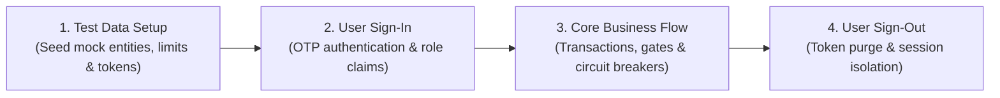

# Logikchain End-to-End Numbered Use Cases Specification & Lifecycle Framework

## 1. Architectural 4-Phase Lifecycle

Every use case in Logikchain adheres to an immutable 4-phase execution lifecycle across all roles, client devices, and integration touchpoints:

1. **Phase 1: Test Data Setup (`setupUseCaseTestData`)**: Pre-conditions and state initialization. Seeds designated entity identifiers (`userId`, `orderId`, `driverId`, `targetSupplierId`), credit limits, geocoded village hubs, and registers mock state payloads into client storage (`localStorage.setItem('lc_test_data_${number}', ...)`).
2. **Phase 2: User Sign-In (`performUserSignIn`)**: Explicit role-based authentication. Executes mobile phone number OTP entry (e.g. `8977848501` / `123123`) or mounts authenticated operator administrative sessions (`dev-token:test_operator_01:support`).
3. **Phase 3: Core Business Flow**: Execution of business transactions, inter-service API calls through API Gateway (`:30080`), database state mutations, and circuit breaker evaluation.
4. **Phase 4: Explicit User Sign-Out (`performUserSignOut`)**: Graceful session termination. Clears `lc_session_user`, `lc_dev_token`, `lc_test_role`, and `lc_support_supplier_context`, verifying clean transition back to the unauthenticated public layout.

---

## 2. Actor Personas

| Actor ID | Persona Role | Description & Primary Capabilities | Client Interface |
|---|---|---|---|
| **`ACT-BUY`** | **Rural Citizen / Consumer Buyer** | Browses local mandi runs, selects village hubs, places prepaid orders, and tracks deliveries. | PWA Mobile Web / `/shop` |
| **`ACT-MER`** | **Kirana Merchant / PUDO Hub** | Manages local inventory, requests wholesale trade credit lines, and completes OTP handovers. | Fullscreen Corridor `/m/gigs` |
| **`ACT-DRV`** | **Transporter / Fleet Driver** | Transports cargo, records CoD collections, passes vehicle departure gates, and turns in cash. | Driver PWA `/d/gigs` |
| **`ACT-SUP`** | **Regional Mill Supplier** | Publishes bulk wholesale inventory, manages credit limits, dispatches cargo, and receives disbursements. | Supplier Portal `/s/*` |
| **`ACT-OPS`** | **Support Operator** | Audits 4-tier geo-hierarchy, acts as proxy for suppliers, validates bulk catalog ingestion, and resolves disputes. | Support Console `/x/*` |
| **`ACT-FIN`** | **Finance & Compliance Officer**| Governs double-entry ledger, audits statutory GST/TDS tax deductions, and reviews 3-way reconciliations. | `/x/config/tax`, `/x/config/tds` |
| **`ACT-SRE`** | **Platform & DevOps Engineer** | Observes 13 microservices, 12 PostgreSQL database pools, and monitors automated E2E test runs. | `/status`, `/status/tests` |

---

## 3. Canonical Numbered Use Cases (`UC-01` to `UC-28`)

### Tier 1: Identity, Roles & Onboarding (`EPIC-01`)

#### `UC-01`: Rural Phone OTP Sign-In & Role Bootstrapping
* **Actor**: `ACT-BUY` (Consumer Buyer)
* **Feature ID**: `FEAT-01.01`
* **Lifecycle**:
  1. **Test Data Setup**: Clears existing sessions, sets active usecase identifier `UC-01`, initializes phone `8977848501` and OTP `123123`.
  2. **User Sign-In**: User visits `/login`, enters phone `8977848501`, requests OTP, inputs `123123`, and validates session creation.
  3. **Core Flow**: Verifies default consumer claims, auth token generation, and renders buyer dashboard greeting.
  4. **User Sign-Out**: Clicks "Sign Out & Switch Account", verifies session token purge, and returns to login prompt.
* **Automated Spec**: [`tests/e2e/pwa/user-flow-login-role-village.spec.ts`](file:///c:/Users/Admin/Downloads/logikchain/logikchain.com/tests/e2e/pwa/user-flow-login-role-village.spec.ts)

#### `UC-02`: Progressive Role Elevation to Kirana Merchant & Fullscreen App Launch
* **Actor**: `ACT-MER` (Kirana Merchant)
* **Feature ID**: `FEAT-01.03`
* **Lifecycle**:
  1. **Test Data Setup**: Seeds user profile `usr_8977848501` with pending merchant upgrade request and supplier context `sup_ongole_01`.
  2. **User Sign-In**: Authenticates merchant session via active token.
  3. **Core Flow**: Submits role elevation request via Support dialog, switches role to Kirana Merchant, launches fullscreen corridor (`/m/gigs`) hiding public chrome, and uses "✕ Close App" handover button to return to web root.
  4. **User Sign-Out**: Discharges merchant role, clears session tokens, and returns to unauthenticated state.
* **Automated Spec**: [`tests/e2e/pwa/user-flow-login-role-village.spec.ts`](file:///c:/Users/Admin/Downloads/logikchain/logikchain.com/tests/e2e/pwa/user-flow-login-role-village.spec.ts)

#### `UC-03`: User Profile Village Selection & PostgreSQL Persistence
* **Actor**: `ACT-BUY` (Consumer Buyer)
* **Feature ID**: `FEAT-01.06`
* **Lifecycle**:
  1. **Test Data Setup**: Stages target village `village_kandukur_523105` and sets mock user state.
  2. **User Sign-In**: Authenticates buyer session.
  3. **Core Flow**: Navigates to `/profile/edit`, selects village `village_kandukur_523105`, saves changes, and verifies atomic PostgreSQL persistence in `identity_db.users` and UI badge updates.
  4. **User Sign-Out**: Explicitly executes sign-out, ensuring no state leakage across tests.
* **Automated Spec**: [`tests/e2e/pwa/user-flow-login-role-village.spec.ts`](file:///c:/Users/Admin/Downloads/logikchain/logikchain.com/tests/e2e/pwa/user-flow-login-role-village.spec.ts)

---

### Tier 2: Commerce, Working Capital & Consignment Fulfillment (`EPIC-02`, `EPIC-05`, `EPIC-08`)

#### `UC-04`: Trade Credit 2-Phase Hold & Headroom Circuit Breaker
* **Actor**: `ACT-MER` (Kirana Merchant)
* **Feature ID**: `FEAT-08.01`
* **Lifecycle**:
  1. **Test Data Setup**: Sets credit limit ₹100,000, current balance ₹0, hold amount ₹4,500, TTL 15 minutes.
  2. **User Sign-In**: Authenticates merchant credentials.
  3. **Core Flow**: Checks credit headroom via `credit-service` (:4008), places synchronous hold, verifies 15-min TTL, and tests circuit breaker rejection when hold exceeds available credit.
  4. **User Sign-Out**: Clears merchant trade context.
* **Automated Spec**: [`tests/e2e/pwa/usecases-commerce.spec.ts`](file:///c:/Users/Admin/Downloads/logikchain/logikchain.com/tests/e2e/pwa/usecases-commerce.spec.ts)

#### `UC-05`: Dynamic UPI QR Intent Generation & Webhook Settlement
* **Actor**: `ACT-MER` (Kirana Merchant)
* **Feature ID**: `FEAT-05.01`
* **Lifecycle**:
  1. **Test Data Setup**: Prepares order `ord_upi_523105`, total ₹12,500, currency INR.
  2. **User Sign-In**: Authenticates merchant session.
  3. **Core Flow**: Generates cryptographically signed dynamic UPI QR intent string via `payments-service` (:4005) and processes simulated HMAC-SHA256 PSP webhook callback with idempotent replay protection.
  4. **User Sign-Out**: Closes session.
* **Automated Spec**: [`tests/e2e/pwa/usecases-commerce.spec.ts`](file:///c:/Users/Admin/Downloads/logikchain/logikchain.com/tests/e2e/pwa/usecases-commerce.spec.ts)

#### `UC-06`: End-to-End Order Creation, Vehicle Departure Gate & OTP Handover
* **Actors**: `ACT-MER`, `ACT-DRV`
* **Feature ID**: `FEAT-02.01`
* **Lifecycle**:
  1. **Test Data Setup**: Prepares consignment line items, vehicle capacity limits, driver `drv_kandukur_01`, and 6-digit handover OTP.
  2. **User Sign-In**: Authenticates merchant ordering session.
  3. **Core Flow**: Submits order, validates cargo against vehicle capacity, clears vehicle departure gate, performs physical delivery, and validates delivery sign-off via master handover OTP.
  4. **User Sign-Out**: Terminates session.
* **Automated Spec**: [`tests/e2e/pwa/usecases-commerce.spec.ts`](file:///c:/Users/Admin/Downloads/logikchain/logikchain.com/tests/e2e/pwa/usecases-commerce.spec.ts)

#### `UC-07`: Order Deliverable Verification, Doorstep Rejection & 72-Hour RTO Protocol
* **Actors**: `ACT-BUY`, `ACT-MER`
* **Feature ID**: `FEAT-02.04`
* **Lifecycle**:
  1. **Test Data Setup**: Stages returnable SKUs, 72-hour retention policy window, and delivery hub identifiers.
  2. **User Sign-In**: Authenticates buyer session.
  3. **Core Flow**: Audits deliverable standards (`/v1/orders/policies/deliverables`), executes line-item doorstep rejection before OTP signoff, and triggers automated 72-hour PUDO RTO return to supplier.
  4. **User Sign-Out**: Clears buyer session.
* **Automated Spec**: [`tests/e2e/pwa/usecases-commerce.spec.ts`](file:///c:/Users/Admin/Downloads/logikchain/logikchain.com/tests/e2e/pwa/usecases-commerce.spec.ts)

---

### Tier 3: Field Custody, Cash Management & Payouts (`EPIC-06`, `EPIC-07`)

#### `UC-08`: CoD Cash Collection, Custody Tracking & Daily Limit Guard
* **Actor**: `ACT-DRV` (Fleet Driver)
* **Feature ID**: `FEAT-07.01`
* **Lifecycle**:
  1. **Test Data Setup**: Initializes driver custody ledger with ₹0 balance and ₹50,000 maximum daily transit ceiling.
  2. **User Sign-In**: Authenticates driver session.
  3. **Core Flow**: Records physical cash collections (`POST /v1/cash/collections`), verifies atomic balance increments, and triggers circuit breaker block when custody exceeds ₹50,000.
  4. **User Sign-Out**: Discharges mobile driver session.
* **Automated Spec**: [`tests/e2e/pwa/usecases-custody-payouts.spec.ts`](file:///c:/Users/Admin/Downloads/logikchain/logikchain.com/tests/e2e/pwa/usecases-custody-payouts.spec.ts)

#### `UC-09`: End-of-Shift Cash Turn-In & Cryptographic Handover OTP Verification
* **Actors**: `ACT-DRV`, `ACT-SUP`
* **Feature ID**: `FEAT-07.02`
* **Lifecycle**:
  1. **Test Data Setup**: Prepares driver custody balance ₹25,000 and cashier terminal ID.
  2. **User Sign-In**: Authenticates driver session.
  3. **Core Flow**: Driver triggers handover declaration, generates 6-digit cryptographic OTP, cashier confirms physical count, and system discharges custody balance to ₹0 with replay prevention.
  4. **User Sign-Out**: Terminates session.
* **Automated Spec**: [`tests/e2e/pwa/usecases-custody-payouts.spec.ts`](file:///c:/Users/Admin/Downloads/logikchain/logikchain.com/tests/e2e/pwa/usecases-custody-payouts.spec.ts)

#### `UC-10`: Cash Discrepancy & The Payout Custody Gate Circuit Breaker
* **Actors**: `ACT-SUP`, `ACT-DRV`, `ACT-OPS`
* **Feature IDs**: `FEAT-07.03`, `FEAT-06.02`
* **Lifecycle**:
  1. **Test Data Setup**: Stages cash shortfall discrepancy record of ₹1,200.
  2. **User Sign-In**: Authenticates driver session.
  3. **Core Flow**: Logs cash shortage, flags driver custody lock, driver attempts earnings withdrawal, system **halts withdrawal with 403 `CASH_CUSTODY_DISCREPANCY_UNRESOLVED`**, support resolves dispute, and retry succeeds.
  4. **User Sign-Out**: Purges auth tokens.
* **Automated Spec**: [`tests/e2e/pwa/usecases-custody-payouts.spec.ts`](file:///c:/Users/Admin/Downloads/logikchain/logikchain.com/tests/e2e/pwa/usecases-custody-payouts.spec.ts)

#### `UC-11`: Bank Beneficiary Registration & KMS Account Encryption
* **Actor**: `ACT-DRV` (Fleet Driver)
* **Feature ID**: `FEAT-06.01`
* **Lifecycle**:
  1. **Test Data Setup**: Prepares test IFSC `HDFC0001234` and bank account number.
  2. **User Sign-In**: Authenticates driver session.
  3. **Core Flow**: Registers beneficiary bank details, encrypts account number via AES-256-GCM envelope encryption, runs penny-drop validation, and verifies masked PII display (`**********7890`).
  4. **User Sign-Out**: Closes driver session.
* **Automated Spec**: [`tests/e2e/pwa/usecases-custody-payouts.spec.ts`](file:///c:/Users/Admin/Downloads/logikchain/logikchain.com/tests/e2e/pwa/usecases-custody-payouts.spec.ts)

#### `UC-12`: Cloud Tasks Asynchronous IMPS Bank Transfer & UTR Settlement
* **Actor**: System / Cloud Tasks Runner
* **Feature ID**: `FEAT-06.03`
* **Lifecycle**:
  1. **Test Data Setup**: Stages approved payout request of ₹8,500 with Section 194C 1% TDS deduction.
  2. **User Sign-In**: Authenticates task runner system session.
  3. **Core Flow**: Cloud Tasks worker decrypts bank credentials, calls banking mock gateway, captures immutable banking UTR reference, updates status to `SETTLED`, and writes CDC outbox event.
  4. **User Sign-Out**: Disconnects worker context.
* **Automated Spec**: [`tests/e2e/pwa/usecases-custody-payouts.spec.ts`](file:///c:/Users/Admin/Downloads/logikchain/logikchain.com/tests/e2e/pwa/usecases-custody-payouts.spec.ts)

#### `UC-13`: Supplier Funds Tracking & Multi-Channel Allocation Governance
* **Actors**: `ACT-OPS`, `ACT-SUP`
* **Feature ID**: `FEAT-06.04`
* **Lifecycle**:
  1. **Test Data Setup**: Prepares supplier escrow balance ₹150,000 with merchant and driver allocations.
  2. **User Sign-In**: Authenticates support operator session.
  3. **Core Flow**: Audits supplier escrow breakdown into PUDO commissions and driver remuneration, verifies **Support Proxy Financial Guardrail (403 block on support role)**, and executes authorized admin disbursement.
  4. **User Sign-Out**: Terminates administrative session.
* **Automated Spec**: [`tests/e2e/pwa/usecases-custody-payouts.spec.ts`](file:///c:/Users/Admin/Downloads/logikchain/logikchain.com/tests/e2e/pwa/usecases-custody-payouts.spec.ts)

---

### Tier 4: Governance, General Ledger & Statutory Compliance (`EPIC-09`, `EPIC-11`)

#### `UC-14`: UPI TPAP Compliance, VPA Syntax Validation & Blacklist Rejection
* **Actor**: `ACT-OPS` (Compliance Officer)
* **Feature ID**: `FEAT-11.01`
* **Lifecycle**:
  1. **Test Data Setup**: Prepares valid and blacklisted VPA formats.
  2. **User Sign-In**: Authenticates compliance officer session.
  3. **Core Flow**: Validates NPCI TPAP guidelines, tests regex syntax validation, and rejects blacklisted handles.
  4. **User Sign-Out**: Terminates session.
* **Automated Spec**: [`tests/e2e/pwa/usecases-governance-ledger.spec.ts`](file:///c:/Users/Admin/Downloads/logikchain/logikchain.com/tests/e2e/pwa/usecases-governance-ledger.spec.ts)

#### `UC-15`: Real-Time AML Fraud Velocity Interception & Account Freeze Gate
* **Actor**: `ACT-OPS` (Compliance Officer)
* **Feature ID**: `FEAT-11.02`
* **Lifecycle**:
  1. **Test Data Setup**: Prepares rapid transaction sequence exceeding velocity threshold.
  2. **User Sign-In**: Authenticates compliance officer session.
  3. **Core Flow**: Intercepts high-velocity transactions (>5/minute or ₹50,000 single transaction), flags high risk score, and triggers automatic account freeze.
  4. **User Sign-Out**: Terminates session.
* **Automated Spec**: [`tests/e2e/pwa/usecases-governance-ledger.spec.ts`](file:///c:/Users/Admin/Downloads/logikchain/logikchain.com/tests/e2e/pwa/usecases-governance-ledger.spec.ts)

#### `UC-16`: Dispute SLA Tracking, 24-Hour Countdown & Regulatory Reporting
* **Actor**: `ACT-OPS` (Support Dispute Specialist)
* **Feature ID**: `FEAT-11.03`
* **Lifecycle**:
  1. **Test Data Setup**: Seeds active dispute order with 24-hour countdown window.
  2. **User Sign-In**: Authenticates support specialist session.
  3. **Core Flow**: Tracks dispute SLA progress, flags overdue breaches, and compiles daily statutory compliance export.
  4. **User Sign-Out**: Terminates session.
* **Automated Spec**: [`tests/e2e/pwa/usecases-governance-ledger.spec.ts`](file:///c:/Users/Admin/Downloads/logikchain/logikchain.com/tests/e2e/pwa/usecases-governance-ledger.spec.ts)

#### `UC-17`: Multi-Role Versioned Clickwrap Policy Consent & Mandatory Re-Consent Gate
* **Actor**: `ACT-OPS` (Legal & Compliance)
* **Feature ID**: `FEAT-11.04`
* **Lifecycle**:
  1. **Test Data Setup**: Stages policy versions (`v2.3` -> `v2.4`) across Buyer, Merchant, and Driver roles.
  2. **User Sign-In**: Authenticates compliance officer session.
  3. **Core Flow**: Audits versioned clickwrap records, triggers policy version bump, and validates mandatory re-consent gate blocking app access until acceptance.
  4. **User Sign-Out**: Terminates session.
* **Automated Spec**: [`tests/e2e/pwa/usecases-governance-ledger.spec.ts`](file:///c:/Users/Admin/Downloads/logikchain/logikchain.com/tests/e2e/pwa/usecases-governance-ledger.spec.ts)

#### `UC-18`: Double-Entry Platform General Ledger & Zero-Sum Invariance Invariant Gate
* **Actor**: `ACT-FIN` (Financial Controller)
* **Feature ID**: `FEAT-09.01`
* **Lifecycle**:
  1. **Test Data Setup**: Prepares double-entry journal batch with debit and credit accounts.
  2. **User Sign-In**: Authenticates finance officer session.
  3. **Core Flow**: Validates immutable double-entry journal balance where total debits equal total credits, rejecting any transaction with non-zero mathematical variance.
  4. **User Sign-Out**: Terminates session.
* **Automated Spec**: [`tests/e2e/pwa/usecases-governance-ledger.spec.ts`](file:///c:/Users/Admin/Downloads/logikchain/logikchain.com/tests/e2e/pwa/usecases-governance-ledger.spec.ts)

#### `UC-19`: Nightly 3-Way Bank Reconciliation & Vertex AI Variance Analysis
* **Actor**: `ACT-FIN` (Financial Auditor)
* **Feature ID**: `FEAT-09.02`
* **Lifecycle**:
  1. **Test Data Setup**: Prepares domain ledger transactions, bank statement lines, and PSP gateway logs.
  2. **User Sign-In**: Authenticates auditor session.
  3. **Core Flow**: Executes automated 3-way reconciliation match, categorizes matching exceptions, and generates variance summary report.
  4. **User Sign-Out**: Terminates session.
* **Automated Spec**: [`tests/e2e/pwa/usecases-governance-ledger.spec.ts`](file:///c:/Users/Admin/Downloads/logikchain/logikchain.com/tests/e2e/pwa/usecases-governance-ledger.spec.ts)

#### `UC-20`: Section 194C/194O TDS Deductions, Government Challan Settlement & Ledger Balancing
* **Actor**: `ACT-FIN` (Tax Auditor)
* **Feature ID**: `FEAT-09.03`
* **Lifecycle**:
  1. **Test Data Setup**: Prepares gross payout and turnover amounts for Section 194C (1% driver) and 194O (1% e-commerce).
  2. **User Sign-In**: Authenticates tax auditor session.
  3. **Core Flow**: Calculates statutory TDS deductions, posts to statutory withholding ledgers, and logs quarterly government challan payment settlement.
  4. **User Sign-Out**: Terminates session.
* **Automated Spec**: [`tests/e2e/pwa/usecases-governance-ledger.spec.ts`](file:///c:/Users/Admin/Downloads/logikchain/logikchain.com/tests/e2e/pwa/usecases-governance-ledger.spec.ts)

#### `UC-21`: Critical Path Roadmap Golden Path Integration
* **Actor**: Platform System / Lead Engineer
* **Feature ID**: `FEAT-12.01`
* **Lifecycle**:
  1. **Test Data Setup**: Verifies readiness across all 6 architecture roadmap stages.
  2. **User Sign-In**: Authenticates system lead session.
  3. **Core Flow**: Verifies end-to-end golden path pipeline across all 6 architectural tiers.
  4. **User Sign-Out**: Terminates session.
* **Automated Spec**: [`tests/e2e/pwa/usecases-governance-ledger.spec.ts`](file:///c:/Users/Admin/Downloads/logikchain/logikchain.com/tests/e2e/pwa/usecases-governance-ledger.spec.ts)

---

### Tier 5: Master Configuration, Geo-Hierarchy & Operations (`EPIC-10`)

#### `UC-22`: Platform 4-Tier Geo-Hierarchy & Village Registry Management
* **Actor**: `ACT-OPS` (Support Operator)
* **Feature ID**: `FEAT-10.01`
* **Lifecycle**:
  1. **Test Data Setup**: Prepares 4-tier geographic master data (Country: India, State: Andhra Pradesh, District: Prakasam, Village: Kandukur).
  2. **User Sign-In**: Authenticates support operator session.
  3. **Core Flow**: Navigates to `/x/config/villages`, audits village registry list items, verifies topbar, and navigates across Countries, States, Districts, and fulfillment Hubs.
  4. **User Sign-Out**: Opens operator dialog, clicks "Sign out", confirms logout, and clears session tokens.
* **Automated Spec**: [`tests/e2e/pwa/config-geo-hierarchy.spec.ts`](file:///c:/Users/Admin/Downloads/logikchain/logikchain.com/tests/e2e/pwa/config-geo-hierarchy.spec.ts)

#### `UC-23`: Commercial SaaS Subscription Plans & Tiered Tariffs
* **Actor**: `ACT-OPS` (Support Operator)
* **Feature ID**: `FEAT-10.02`
* **Lifecycle**:
  1. **Test Data Setup**: Stages subscription tiers (Silver, Gold, Platinum) and platform tariffs.
  2. **User Sign-In**: Authenticates support operator session.
  3. **Core Flow**: Audits subscription plans at `/x/config/plans`, reviews monthly GMV ceilings, and audits platform tariff controls at `/x/config/tariffs`.
  4. **User Sign-Out**: Executes explicit sign-out and purges tokens.
* **Automated Spec**: [`tests/e2e/pwa/config-subscription-plans.spec.ts`](file:///c:/Users/Admin/Downloads/logikchain/logikchain.com/tests/e2e/pwa/config-subscription-plans.spec.ts)

#### `UC-24`: Statutory Commodity Tax Profiles & Regional GST Rates
* **Actor**: `ACT-FIN` (Compliance Officer)
* **Feature ID**: `FEAT-10.03`
* **Lifecycle**:
  1. **Test Data Setup**: Stages commodity GST rates (0% essential grains, 5% pulses, 18% consumer goods) and Section 194C/194O TDS profiles.
  2. **User Sign-In**: Authenticates compliance officer session.
  3. **Core Flow**: Navigates to `/x/config/tax`, audits GST profiles, navigates to `/x/config/tds`, and reviews statutory withholding configuration.
  4. **User Sign-Out**: Executes explicit sign-out and purges tokens.
* **Automated Spec**: [`tests/e2e/pwa/config-tax-profiles.spec.ts`](file:///c:/Users/Admin/Downloads/logikchain/logikchain.com/tests/e2e/pwa/config-tax-profiles.spec.ts)

#### `UC-25`: Supplier Bulk Ingestion & Selective Entity Loader
* **Actor**: `ACT-OPS` (Support Operator)
* **Feature ID**: `FEAT-10.08`
* **Lifecycle**:
  1. **Test Data Setup**: Stages 11-category supplier catalog spreadsheet for `sup_ongole_01` and 14-char invalid GSTIN payload.
  2. **User Sign-In**: Authenticates support operator session.
  3. **Core Flow**: Navigates to `/x/config/supplier-ingestion`, audits 11 entity category toggles, executes pre-flight dry-run validation, triggers invalid 14-character GSTIN error, verifies `VALIDATION_FAILED` alert, and validates commit button locking.
  4. **User Sign-Out**: Executes explicit sign-out and purges tokens.
* **Automated Spec**: [`tests/e2e/pwa/support-supplier-bulk-ingest.spec.ts`](file:///c:/Users/Admin/Downloads/logikchain/logikchain.com/tests/e2e/pwa/support-supplier-bulk-ingest.spec.ts)

#### `UC-26`: Support-as-Supplier Proxy Impersonation & Audit Trail
* **Actor**: `ACT-OPS` (Support Operator acting on behalf of `ACT-SUP`)
* **Feature ID**: `FEAT-10.04`
* **Lifecycle**:
  1. **Test Data Setup**: Stages authorized proxy contexts (`sup_ongole_01`, `sup_krishna_01`).
  2. **User Sign-In**: Authenticates support operator session.
  3. **Core Flow**: Accesses proxy dropdown in `/x/ops` topbar, selects `sup_ongole_01`, confirms persistence of `lc_support_supplier_context`, verifies immutable dual audit headers, and tests financial mutation exclusion guardrail.
  4. **User Sign-Out**: Resets proxy context, signs out, and clears headers.
* **Automated Spec**: [`tests/e2e/pwa/support-supplier-proxy.spec.ts`](file:///c:/Users/Admin/Downloads/logikchain/logikchain.com/tests/e2e/pwa/support-supplier-proxy.spec.ts)

---

### Tier 6: Observability, Infrastructure & QA Console (`EPIC-12`)

#### `UC-27`: Microservices Mesh Health & Database Isolation Probes
* **Actor**: `ACT-SRE` (Platform / SRE Engineer)
* **Feature ID**: `FEAT-12.01`
* **Lifecycle**:
  1. **Test Data Setup**: Probes API Gateway `:30080` (NodePort) and 13 backend microservice endpoints.
  2. **User Sign-In**: Connects SRE observer telemetry session.
  3. **Core Flow**: Navigates to `/status`, validates API Gateway connection status, confirms all 13 microservices online, audits active PostgreSQL database connections across 12 isolated database pools, and triggers live connection refresh.
  4. **User Sign-Out**: Disconnects telemetry observer session.
* **Automated Spec**: [`tests/e2e/pwa/status-services.spec.ts`](file:///c:/Users/Admin/Downloads/logikchain/logikchain.com/tests/e2e/pwa/status-services.spec.ts)

#### `UC-28`: Live E2E Test Runner, Results Review & Video Playback Console
* **Actor**: `ACT-SRE` (QA / Lead Engineer)
* **Feature ID**: `FEAT-12.02`
* **Lifecycle**:
  1. **Test Data Setup**: Stages test runner suite definitions, test duration metrics, and WebM video recordings.
  2. **User Sign-In**: Connects QA lead session.
  3. **Core Flow**: Navigates to `/status/tests`, audits metrics cards (Total Use Cases, Passing Tests, Video Recordings), opens WebM recording modal, tests playback speed controls (0.5x, 1x, 1.5x, 2x), inspects verified flow checkpoints, and reviews execution log modal.
  4. **User Sign-Out**: Closes QA console and purges session tokens.
* **Automated Spec**: [`tests/e2e/pwa/status-test-runner.spec.ts`](file:///c:/Users/Admin/Downloads/logikchain/logikchain.com/tests/e2e/pwa/status-test-runner.spec.ts)
